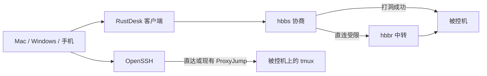

# Desklink

同一账号可从 Mac、Windows 和手机浏览器查看设备、远程桌面和使用 Web SSH。账号入口复用开源 MeshCentral。Desklink 命令行也支持 RustDesk 原生客户端和 OpenSSH，持久会话交给被控机上的 tmux。

## RustDesk 原生整合版

`native/` 为 RustDesk 1.5.3 的桌面和移动端连接页加入「Desklink」。应用内登录现有账号，设备卡片可分别打开原生桌面、SSH 终端和原生文件管理器。桌面和文件管理器使用 RustDesk 网络设置里的自建 ID 服务器与公钥，由 RustDesk 设备凭据授权。应用内 SSH 使用账号服务上已保存的 SSH 凭据。

1. 获取 RustDesk 1.5.3 的源码，应用接入补丁并按上游的对应平台流程构建。 [RustDesk 构建文档](https://rustdesk.com/docs/en/dev/build/)

   ```sh
   git clone --branch 1.5.3 --recurse-submodules https://github.com/rustdesk/rustdesk.git
   node native/prepare.cjs rustdesk
   ```

2. 在账号后台给同一个 SSH 设备的备注加一行 `RustDesk ID: 123456789`，替换为该机的 ID。在账号后台保存可自动登录的 SSH 凭据，在 RustDesk 被控机的安全权限里开启文件传输。
3. 在 RustDesk 的网络设置使用自建 ID 服务器及公钥。在「Desklink」输入账号入口、用户名和密码。开发者也可以用 `--dart-define=DESKLINK_ACCOUNT_URL=https://desklink.example.com/` 预填入口。浏览器版账号入口可继续用于管理设备。

RustDesk 衍生客户端沿用上游 AGPL-3.0 许可。 [RustDesk 1.5.3 许可](https://github.com/rustdesk/rustdesk/blob/1.5.3/LICENCE)

## 账号登录与设备列表

1. 在常开的 Mac 或 Linux 主机安装 Node.js 20+，进入 `account/`，运行 `npm ci --ignore-scripts`。创建 `meshcentral-data/`，将 [config.example.json](account/config.example.json) 复制为 `meshcentral-data/config.json`。把配置里的 `desklink.example.com` 换成账号入口的 HTTPS 主机名。反向代理在同一台主机运行，转发到 `127.0.0.1:24443`。
2. 运行 `npm start`。先从服务器的浏览器或通过 SSH 端口转发打开 `http://127.0.0.1:24443`，在对外启用反向代理之前创建首个管理员。配置关闭后续自助注册。数据目录保存账号、设备和服务器密钥，只对部署用户开放。
3. 使用现有 Tailscale 时，在服务器执行 `tailscale serve --bg --https=443 http://127.0.0.1:24443`，把生成的 HTTPS 地址用作账号入口。反向代理就绪后重启 MeshCentral，让它读取 Agent 将看到的 TLS 证书。手机、控制端和运行 Agent 的设备均需接入同一 tailnet。 [Tailscale Serve](https://tailscale.com/docs/reference/tailscale-cli/serve) · [MeshCentral 配置项](https://github.com/Ylianst/MeshCentral/blob/1.3.1/meshcentral-config-schema.json)
4. 用同一个 Desklink 账号在各端登录。在「我的设备」创建 Agent 设备组，用该组生成的 MeshAgent 安装包登记被控 Mac 或 Windows。被控 Mac 需授权屏幕录制和辅助功能。手机从设备页打开桌面，可使用触控和会话键盘。 [MeshCentral 使用手册](https://ylianst.github.io/MeshCentral/)
5. 要使用真实 OpenSSH，在服务器可达的网络上创建本地设备组，添加 SSH 主机。MeshCentral 与 SSH 服务在同一台主机时，地址用 `127.0.0.1`。在设备的终端页打开 SSH，首次使用时填入该主机的 SSH 用户名和凭据。可为这个设备使用独立密钥并由 MeshCentral 保存到当前账号，手机后续可复用。运行 `tmux -L desklink new-session -A -s research` 可接回同名会话。

账号权限覆盖这个入口的设备列表、远程桌面和 Web SSH。各设备的 OS 登录凭据独立。现有 RustDesk 或原生 OpenSSH 入口使用自身鉴权。

电脑也可通过已有 SSH 跳板打开账号入口。将 `mac-mini` 换成部署主机的 SSH 别名，运行 `ssh -N -L 127.0.0.1:24443:127.0.0.1:24443 mac-mini`，然后在浏览器打开 `http://127.0.0.1:24443` 登录。

## 原生客户端连接



| 能力 | 使用方式 |
| --- | --- |
| 远程桌面、音视频、剪贴板和文件 | RustDesk 原生客户端。硬件编解码和自适应码率由 RustDesk 管理。 |
| 多开 | 桌面端在 RustDesk 的标签页或独立窗口里开多台设备。SSH 端为每项工作创建一个命名的 tmux 会话。 |
| 手机 | iOS / Android 的 RustDesk 可控制 Mac 和 Windows。会话工具栏可选触控、虚拟鼠标、屏幕键盘。iOS 扮演主控端。 |
| 终端 | RustDesk 菜单里的终端使用 RustDesk 的连接和鉴权。`desklink ssh` 和 `desklink term` 使用 OpenSSH 及已有 SSH 密钥。 |

## 自托管桌面

1. 在一台可从客户端访问的 Linux 主机安装 Docker 和 Compose，把 [compose.yaml](compose.yaml) 放入工作目录。在同目录的 `.env` 填写 `DESKLINK_RELAY_ADDRESS=remote.example.com:21117`。
2. 在云防火墙放行 `21115/TCP`、`21116/TCP+UDP`、`21117/TCP`。启动容器并读取公钥。

   ```sh
   docker compose up -d
   docker compose ps
   head -c 100 data/id_ed25519.pub
   ```

3. 在两端安装 [RustDesk 1.5.3](https://github.com/rustdesk/rustdesk/releases/tag/1.5.3)。在设置 → 网络 → ID/中继服务器填 `ID Server` 和 `Key`。Compose 中的 `hbbs` 会向客户端下发中继地址，`Relay Server` 和 `API Server` 留空。也可复制 `desklink profile` 的输出，然后在同一页面点「导入服务器配置」。
4. 在被控 Mac 的系统设置中给 RustDesk「屏幕与系统音频录制」和「辅助功能」权限。需要无人值守时，按被控端提示安装服务并设置独立的强密码。桌面首次连通后，在会话工具栏确认连接显示为 `Direct` 或 `Relay`，并验证键鼠输入。手机用 Wi‑Fi 和蜂窝网络各试一次。 [macOS 权限说明](https://rustdesk.com/docs/en/client/mac/) · [自托管客户端配置](https://rustdesk.com/docs/en/self-host/client-configuration/)

只分发 `id_ed25519.pub` 的内容，私钥保留在服务端 `data/`。远程桌面通过 RustDesk ID 建连。直连能否成功取决于两端网络，中转流量消耗 VPS 带宽。 [端口与直连说明](https://rustdesk.com/docs/en/self-host/rustdesk-server-oss/install/)

## 使用已有 Tailscale

Mac、Windows 和手机加入同一个 tailnet 后，可在被控端设置 → 安全中开启「IP 直连」并将来源 IP 白名单设为你的 Tailscale 设备地址。将被控机的 Tailscale `IPv4:21118` 填到 `address`。若同时填写 `id`，面板主按钮会通过 RustDesk 设备 ID 建连，旁边的「IP 直连」链接使用这个地址。填写自托管服务器和公钥后，设备 ID 链接会带上这两项连接配置。旧配置中的 `id: "IPv4:port"` 仍可使用。IP 直连模式由 Tailscale 提供链路加密，`tailscale ping` 可查看底层是点对点还是 DERP。 [RustDesk IP 直连](https://rustdesk.com/docs/en/self-host/client-configuration/advanced-settings/#direct-server) · [Tailscale 连接类型](https://tailscale.com/docs/reference/connection-types)

## Mac / Windows 命令行

需要 Go 1.23+ 进行源码构建。运行时使用已安装的 RustDesk 和 OpenSSH Client。示例里的 `mac-mini` 是 SSH 配置的 Host 别名，可以使用 `ProxyJump`。先确认 `ssh mac-mini hostname` 成功。

1. 在 macOS 终端或 PowerShell 中运行 `go build .`。从 [desklink.example.json](desklink.example.json) 复制一份 `desklink.json` 到二进制同目录，配置 RustDesk 设备 ID `id`、可选的内网 `address`、SSH 别名和自托管服务器公钥。密码和私钥保留在各自客户端。
2. macOS 用 `./desklink`，PowerShell 用 `./desklink.exe`。

   ```text
   desklink list
   desklink profile
   desklink desktop mini
   desklink files mini
   desklink terminal mini
   desklink ssh mini "hostname && whoami"
   desklink term mini research
   desklink term mini logs
   desklink sessions mini
   ```

3. tmux 默认用 `Ctrl+B` 再按 `D` 脱离。重新运行相同名字的 `term` 命令即可接回会话。tmux 需安装在 SSH 目标机且位于 SSH 的 `PATH`。Windows 可作为 SSH 控制端，Windows 被控机本身的原生命令行使用 `ssh` 或 RustDesk 的 `terminal`。

## 通过已有 SSH 跳板连接桌面

当 SSH 别名已经能通过 `ProxyJump` 连到目标时，Mac 或 Windows 可以用同一个别名转发 RustDesk。用 `address` 指定被控机自身可达的 RustDesk `IPv4:port`，用 `ssh_local_port` 指定本机未占用的端口。被控端启用 IP 直连，并允许该机访问自身地址时使用的来源 IP。多个设备各用一个本机端口。

1. 在一个终端中运行 `desklink tunnel mini`，保留该窗口。OpenSSH 只在客户端的 `127.0.0.1` 监听，并为转发提供加密。
2. 在另一个终端中运行 `desklink -via-ssh desktop mini`。`files` 和 `terminal` 也支持 `-via-ssh`，可以共用这条隧道。
3. 在隧道窗口按 `Ctrl+C` 停止转发。

桌面串流或大文件传输和终端一起使用时，可用 `ssh_tunnel` 指定独立的 SSH 别名。终端仍走 `ssh`。若使用跳板，在这个隧道别名和它的 `ProxyJump` 别名上分别设置 `ControlMaster no` 和 `ControlPath none`，使数据流与交互终端分开。大文件也可通过独立别名传输。

## 大文件传输

Mac 和 Windows 可用系统 OpenSSH 的 SFTP 模式传文件或目录。两个命令使用配置里的 `ssh_tunnel` 别名，禁用压缩和连接复用。经 VPS 跳板时，`ssh_tunnel` 和对应跳板别名分别关闭复用，使文件传输与交互终端使用独立连接。路径中的空格用引号保护。

```text
desklink send mini "./dataset.tar" "/Users/remote/dataset.tar"
desklink get mini "/Users/remote/dataset.tar" "./dataset-copy.tar"
```

速度取决于链路带宽。传输到已有路径时，OpenSSH 按目标路径执行覆盖，重要文件可先传到新文件名。App 的「传输文件」按钮使用 RustDesk 原生文件管理器，直连和中继受实际网络条件影响。 [OpenSSH 文件传输说明](https://man.openbsd.org/scp) · [RustDesk Android 文件传输](https://rustdesk.com/docs/en/client/android/#file-transfer-android)

手机可继续用同一台被控机的 Tailscale 地址。 [OpenSSH 本地端口转发](https://man.openbsd.org/ssh#L) · [RustDesk IP 直连](https://rustdesk.com/docs/en/self-host/client-configuration/advanced-settings/#direct-server)

## 手机使用原生客户端

1. 在常开的 Mac 上运行 `desklink panel`。面板读取启动时的 `desklink.json`，在 `127.0.0.1:22180` 提供设备列表。
2. 要从手机打开面板，在同一台主机用 `tailscale serve --bg --http=22180 http://127.0.0.1:22180`，然后在手机浏览器打开命令返回的 MagicDNS URL。手机和主机须加入同一个 tailnet。 [Tailscale Serve](https://tailscale.com/docs/reference/tailscale-cli/serve)
3. 点击远程桌面可交给已安装的 RustDesk，也可长按复制目标地址。IP 直连设备有 `ssh_user` 时，面板会显示用于 SSH 客户端的 `用户名@地址`，使用被控机默认的 SSH 端口 22。
4. 配置了自托管服务器时，可展开「RustDesk 服务器配置」，复制整段文本，在 RustDesk 的「ID/中继服务器」中导入。

浏览器启用系统代理时，将面板的 MagicDNS 域名加入直连规则。面板由 Tailscale 内网提供。

- [iPhone / iPad](https://apps.apple.com/app/rustdesk-remote-desktop/id1581225015) 和 [Android](https://github.com/rustdesk/rustdesk/releases/tag/1.5.3) 使用相同的 RustDesk 服务器设置。保存目标 ID 到收藏，在远程桌面底栏打开键盘，或在手势帮助里开启虚拟鼠标。 [移动端模式](https://rustdesk.com/docs/en/self-host/client-configuration/advanced-settings/#show-virtual-mouse)
- 要在手机上使用 OpenSSH，选支持 SSH 密钥及跳板的客户端，分别配置自己的手机密钥和跳板。连上目标后执行 `tmux -L desklink new-session -A -s research`，即可接回桌面命令行创建的会话。 [Electerm](https://github.com/electerm/electerm) · [tmux](https://github.com/tmux/tmux/wiki/Getting-Started)

## 许可

Desklink 原创代码使用 MIT。账号入口从 npm 安装采用 Apache-2.0 的 MeshCentral。RustDesk 的客户端和 OSS 服务端由各平台独立安装，使用上游 AGPL 许可。 [MeshCentral 许可](https://github.com/Ylianst/MeshCentral/blob/1.3.1/LICENSE) · [RustDesk 客户端](https://github.com/rustdesk/rustdesk) · [RustDesk Server OSS](https://github.com/rustdesk/rustdesk-server)

## 构建产物

GitHub Actions 在 macOS 和 Windows 的 x64、ARM64 运行器上构建，产物包含启动器、示例配置和说明。Windows 测试用临时协议处理程序接收 `desktop`、`files` 和 `terminal` 发出的链接，并逐条核对地址。实际远程画面和键鼠由 RustDesk 会话验收。

Windows 的 SSH 集成测试用系统 OpenSSH、临时密钥和回环测试主机验证 `ProxyJump`、命令执行及桌面端口转发。测试依赖位于独立的 `scripts/sshfixture` 模块。
